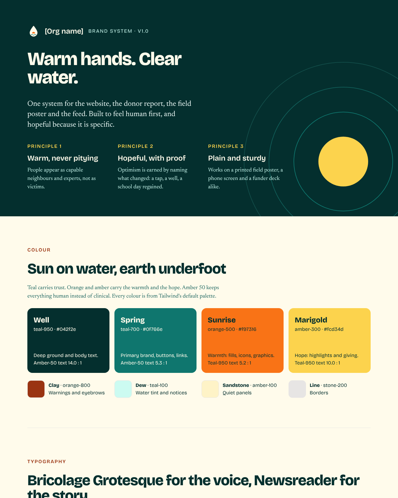

# 1. Create a design system

A design system is the set of rules every screen follows: which fonts, which colours, how much space between things, and how a button or a card is built. We decide them once, and Claude applies them everywhere. Without one, you correct colours and corners on every screen separately.

In the session we built one in Claude Design for a fictional nonprofit working on water scarcity. This folder has the result:

- [`design-system.html`](design-system.html): the colours, type and components on one page you can open in a browser
- [`tokens.css`](tokens.css): the design system as CSS variables, exported from Claude Design
- [`tailwind-theme.css`](tailwind-theme.css): the same system as a Tailwind theme, from step 2



## Prompt 1: let Claude ask you questions first

Open the Claude desktop app or claude.ai, go to Design, and start a new design. Paste this with your own organisation and topic:

```
Help me create a design system for [my org], which works on [topic].
Before you build anything, ask me 3 short questions, one at a time: who it's for, the mood, and any brand colours or fonts I already use.
Then set up type, colour, spacing and components (buttons, cards, a stat block, a simple chart).
Show me a sample page that uses all of it.
```

Questions first give Claude context and limits before it starts guessing. Our answers in the session were the whole brand, warm and hopeful, and no existing colours or fonts. We used Sonnet, which is enough for this step.

On a real project we'd change two things:

- **Ask for options before picking one.** Add "Show me five different directions first, and don't build anything until I pick one." You choose the look before Claude commits to it.
- **Say what you want back.** Our prompt was short, so Claude also built components and social posts. If you only want the palette and fonts at this stage, list them and add "don't create components yet."

## Prompt 2: review with comments, then resolve them

Switch to comment mode and click on the element you want changed. Untick **Send to Claude** while you write, so Claude waits until you've left all your comments. Our two comments were:

```
Make form text sans serif.
```
```
Ensure the minimum font size is 16px.
```

Then send one message:

```
Resolve the comments.
```

## Prompt 3: build the first components

```
Create some primitive components based on this design system: a hero banner, cards and forms. Put them on a new page.
```

Components are the small building blocks made from the system. A card is a heading, a block of text, an image, a border and a button, built the same way every time. A new page keeps each piece separate, which makes exporting easier later.

Next: [2. Add build rules](../02-build-rules/)
