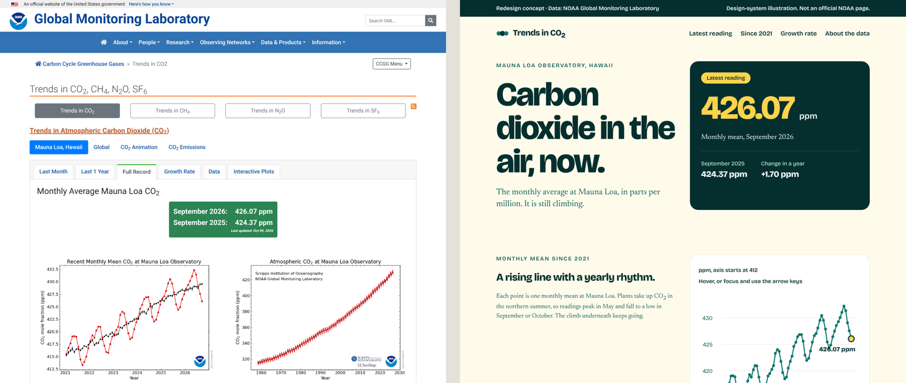

# 4. Redesign a real page

Next we applied the design system to a page that exists today: NOAA's [Trends in Atmospheric Carbon Dioxide](https://gml.noaa.gov/ccgg/trends/). It holds the longest record of direct CO₂ measurements in the atmosphere, and it's hard to read if you aren't a scientist.

- [`redesign.html`](redesign.html): the redesign concept. Open it in a browser. The line chart and bar charts respond to hover, tap and the arrow keys.



We kept the water nonprofit's colours to show that one system can be applied to any page.

## The prompts

Paste these one at a time, in Claude Code as we did in the session, or in Claude Design. Check each answer before moving on.

**1. Set the context and read the page.**

```
This is a teaching demo. We're making an illustrative redesign concept of NOAA's public "Trends in CO2" page (gml.noaa.gov/ccgg/trends) to show how a design system improves a data page. It's a concept, not a copy or a replacement: no NOAA logo or branding, and a visible credit line, "Redesign concept · Data: NOAA Global Monitoring Laboratory". The data is public NOAA data.
First, read the page. List its content blocks, its key numbers, and the five biggest reasons it's hard to read. Don't design anything yet.
```

Without this framing, Claude may stop partway through to ask whether it should recreate another organisation's page.

**2. Plan the page before any visuals.**

```
Plan one page for a curious non-scientist. Lead with the latest monthly reading and the change from a year ago. Then one chart of the full record with a dashed line at the pre-industrial 280 ppm. Then three short explainers: what Mauna Loa measures, why CO2 rises every year, and why it dips each summer. Put methodology and downloads in a collapsed section at the bottom. Show me the outline as a list first.
```

**3. Build it with the design system.**

```
Now design the page with our design system and the tailwind-design rules: tokens only, WCAG AA contrast on every text and background pair, flexbox first, nothing below 16px. Use the accent colour only on the latest reading. Use the real numbers from the page, and keep the credit line visible at the top and bottom.
```

In Claude Code, add: `Do a simple proof of concept as a local HTML file.`

**4. Optional: change one token.**

```
Change the primary colour token to [deep blue] and list every element that updated.
```

The numbers in `redesign.html` come from NOAA's page as it stood in October 2026. Claude read the monthly points in the line chart off NOAA's published chart, to about 0.1 ppm. For any real use, take the figures from NOAA's data files.

Next: [5. Make it move](../05-motion/)
