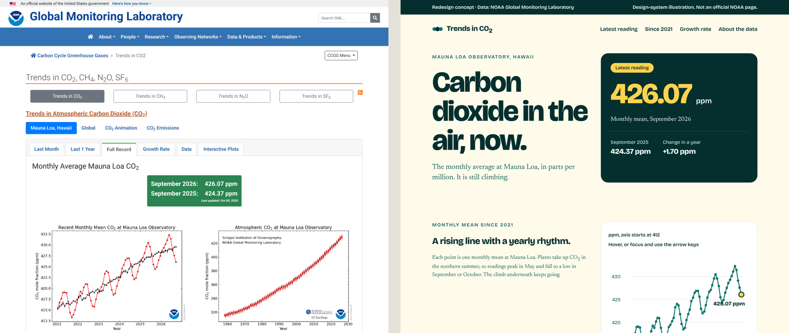

# Claude Design for climate and impact work

The prompts, files and code from Terra Studio's Claude Design session on 16 October 2026.

**Recording:** [watch the session](RECORDING_URL) · **Slides:** [open the deck](slides/)

Each folder is one step of the session, in the order we did them. Each has the prompts, a note on what each prompt asks for, and the files it produced.

| Step | What you'll make | Tools |
|---|---|---|
| [1. Create a design system](01-design-system/) | A colour, type, spacing and component system for a fictional water nonprofit | Claude Design |
| [2. Add build rules](02-build-rules/) | The same system as Tailwind tokens, with a skill that enforces contrast and type size | Claude Design, the tailwind-design skill |
| [3. Take it into Claude Code](03-claude-code/) | A CSS file and an HTML page that show the system in code | Claude Code |
| [4. Redesign a real page](04-redesign-a-page/) | A redesign concept of NOAA's Trends in CO₂ page, built on that system | Claude Code or Claude Design |
| [5. Make it move](05-motion/) | Two short videos of 66 years of Mauna Loa CO₂ data, one of them a 3D Earth | Claude Code, Remotion |

## What you need

- A Claude account. Steps 1 and 2 need nothing else.
- [Claude Code](https://docs.claude.com/en/docs/claude-code/overview) for steps 3 to 5.
- [Node.js](https://nodejs.org) 18 or later for step 5.

To skip copying files by hand, open Claude Code in an empty folder and paste: `Clone https://github.com/OWNER/REPO and walk me through the README, one step at a time.`

## Why we start with design

Climate and impact work usually puts design last. We spend months on the research and the message, then present it with default settings, and the reader has to work out what 300 ppm means and why it matters.

A design system is a set of rules for type, colour, spacing and components that we decide once and Claude applies everywhere. It keeps the work consistent, and a change to one rule carries through every page.

Asking for "a website for a nonprofit working on water scarcity" in one prompt usually gets you a generic page. So we decide the system first, then build in small steps and check each result before the next.

## Credits and licences

- CO₂ data: [NOAA Global Monitoring Laboratory](https://gml.noaa.gov/ccgg/trends/), Mauna Loa Observatory. Public domain. The redesign is an illustrative concept for teaching and is not an official NOAA page.
- [Remotion](https://www.remotion.dev) is free for individuals, non-profits and companies of up to three people. Larger companies need a [company licence](https://www.remotion.dev/license).
- The [Remotion skill](https://github.com/haidrrrry/claude-remotion-skill) for Claude Code is by haidrrrry, under the MIT licence.
- The fonts (Bricolage Grotesque, Newsreader, DM Sans, IBM Plex Mono) are under the SIL Open Font License.
- The Earth textures come from the [three.js examples](https://github.com/mrdoob/three.js/tree/dev/examples/textures/planets). The motion project downloads them with a script, so they aren't stored here.
- Everything else in this repo is under the MIT licence. See [LICENSE](LICENSE).

## About Terra Studio

This session was one of Terra Studio's free Build With Us events. Terra Studio is an eight-week intensive where climate and impact professionals learn responsible AI, data, agents and storytelling, and build a working project each week. Fellows' projects are at [studio.terra.do/built](https://studio.terra.do/built?utm_source=github), and the Intensive is at [studio.terra.do](https://studio.terra.do/intensive?utm_source=github).
